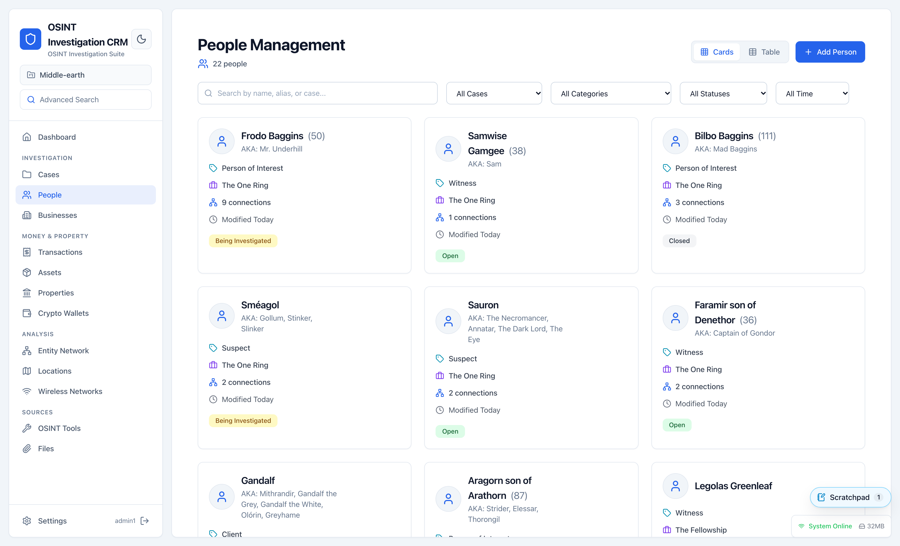
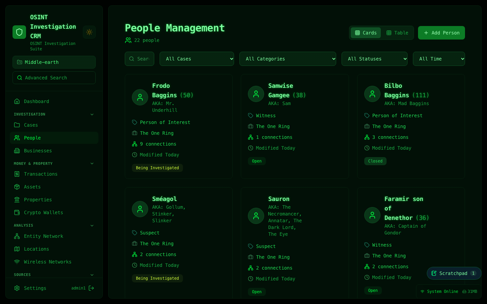
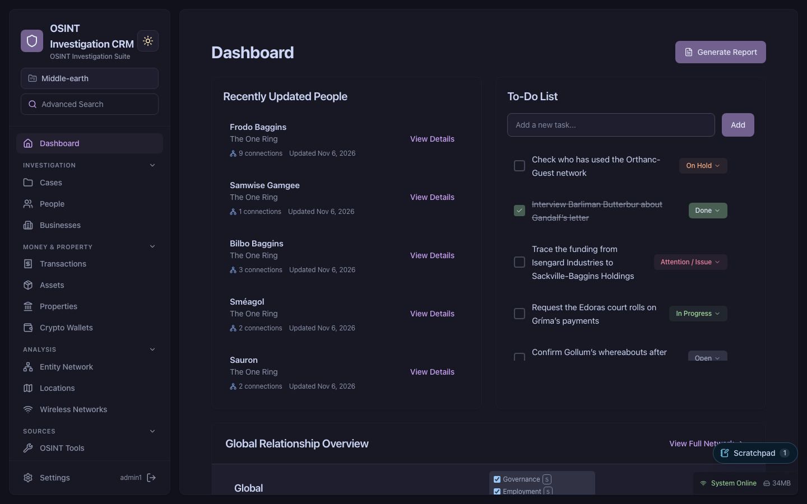

# 👻 GHOST - Global Human Operations & Surveillance Tracking
## OSINT Investigation CRM


> *"Because Excel sheets are for accountants, not investigators"*

> ## 🎉 GHOST 3.0 is here!
>
> The biggest update yet: GHOST has been rebuilt on a modern foundation, and you'll feel it from the first click.
>
> - ⚡ **Faster.** The app now downloads about a quarter of what it used to on first load; maps, graphs and reports load the moment you open them, and only your language is downloaded.
> - 🧭 **Remembers where you were.** Switch sections and come back to the same search, filters, tabs and scroll position.
> - 📱 **Better on phones and tablets.** Long lists fit their content, and row actions are always within reach on touch screens.
> - 🛡️ **Safer by design.** A strict content security policy, hardened headers, no third-party CDN requests, and rate limits that survive restarts.
> - 🌍 **Your language, your formats.** Dates and numbers follow the language you choose, and Russian counts read correctly.
> - 🍏 **Runs on ARM.** Ready-made images for Apple Silicon Macs, Raspberry Pis and ARM servers.
> - 🧪 **Tested like never before.** Component tests in a real browser, and screenshot checks of every screen in light, dark, left-to-right and right-to-left.
>
> Under the hood: React 19 with the React Compiler, Vite, Tailwind CSS 4, React Router 8, i18next 26 and Node.js 26. Upgrading from 2.x? Read the **[3.0 upgrade notes](#upgrading-to-30)** first — it takes a minute and covers the few things that changed for operators.

A full-stack, self-hosted OSINT investigation management system with a modern interface — built for individual investigators, researchers, and hobbyists who want structured case management without spreadsheets. See [Project Status](#-project-status) below for maintenance posture and intended use.




## 📌 Project Status

**Actively maintained, single-maintainer, self-hosted hobby/research project.** Not a commercial product.

- **Maintenance:** Actively maintained by one author. Security reports and bug reports are triaged on a best-effort basis — typically within days, not hours. There is no SLA, no on-call rotation, and no paid support tier.
- **Intended audience:** Individual investigators, researchers, students, and hobbyists self-hosting on infrastructure they control. The "investigation CRM" framing describes the *feature set*, not a claim of enterprise-grade operational guarantees.
- **Production deployments:** Possible, but you are the operator. You are responsible for HTTPS termination, backups, network isolation, OS patching, threat modelling for your data, and meeting any regulatory obligations that apply to the data you store. See [SECURITY.md](SECURITY.md) for the current hardening posture and known limitations.
- **Not suitable for:** Multi-tenant SaaS, regulated environments without your own additional controls (HIPAA, GDPR-regulated PII at scale, law-enforcement evidentiary chains), or any deployment where loss of availability or data integrity has third-party consequences without your own redundancy and review.
- **Reporting issues:** Open a GitHub issue. For security-sensitive reports, follow the disclosure process in [SECURITY.md](SECURITY.md).

If this project is ever shelved, this section will be updated and the repository will be archived.

## 🎯 Core Features

### 🧑‍💼 People Management
- **Role-based categorization**: Suspects, Witnesses, Persons of Interest, Associates, Victims
- **Comprehensive tracking**: Addresses, phone numbers, emails, social media handles
- **Travel history**: Timeline and analysis of person movements
- **Case associations**: Link people to specific investigations
- **Status tracking**: Active, Inactive, Under Investigation, Cleared
- **Custom fields**: Extend person profiles with custom data fields
- **Advanced search**: Multi-parameter search with filters

### 🔗 Entity Network Visualization
- **Interactive relationship diagrams**: Visual network mapping with React Flow
- **Multi-entity support**: People, businesses, locations, phones, emails
- **Connection types**: Family, Business, Criminal, Social, Known Associates
- **Drag-and-drop interface**: Intuitive node manipulation
- **Real-time updates**: Live relationship mapping
- **Network filtering**: Focus on specific entity types and relationships

### 🗺️ Global Intelligence Map
- **Geocoded locations**: Automatically geocode addresses with database caching
- **Clustered markers**: Performance-optimized clustering for large datasets
- **Person-location correlation**: Visual tracking of person movements
- **Interactive popups**: Detailed location information on click
- **Map filters**: Filter by person, date range, or location type

### 📡 Wireless Network Intelligence (WiGLE Integration)
- **Manual network entry**: Add wireless networks manually with comprehensive forms
- **KML import**: Import WiGLE wardriving data
- **Network tracking**: SSID, BSSID, encryption, signal strength, passwords
- **WiFi 7 support**: Full support for WiFi 7 frequency bands (2.4GHz, 5GHz, 6GHz)
- **Multi-entity associations**: Link networks to multiple people and businesses
- **Person association**: Link wireless networks to investigations
- **Map visualization**: Wireless networks appear on global map with WiFi icons
- **Map toggle**: Show/hide wireless networks on map
- **Advanced filtering**: Filter by signal strength, encryption, KML file source
- **Location preview**: Interactive map in detail view
- **Flexible validation**: Only SSID required, BSSID and location optional

### 🛠️ OSINT Tools & Integrations
- **Generic tools**: a catalogue of OSINT links with categories, tags and notes
- **Integrated tools**: GHOST searches crt.sh, Wayback Machine, Gravatar, IPinfo, urlscan.io, Have I Been Pwned, Hunter.io, Shodan and VirusTotal for you
- **Search from a person**: run searches on a person's emails, domains, IPs and usernames, then add findings back, marked unverified with their source
- **Community integrations**: integrations are JSON files, not code; see [`integrations/`](integrations/) to add your own
- **Integration builder**: connect a new service step by step, testing it live and clicking the response to choose result fields; no JSON editing
- **Central management**: admins share tools with everyone or selected projects, decide whether users may add their own, and choose shared or per-user API keys
- **Export / import** tool lists with or without configuration; API keys travel encrypted with a passphrase

### ✅ Task Management
- **Investigation todos**: Linked to cases and people
- **Priority levels**: Low, Medium, High, Urgent
- **Status tracking**: Pending, In Progress, Completed
- **Case assignment**: Organize tasks by investigation

### 📝 Scratchpad
- **Floating notepad** in a corner of every page for pasting and quick notes; it stays put while you switch pages, projects and windows, and keeps its text when closed
- **Markdown**, rendered: headings, lists, tables, code, links, and `- [ ]` tick boxes you can click
- **Capture from anywhere**: select text in GHOST and click *Add to scratchpad* (or press `Alt+Shift+A`); the note records where it came from. `Alt+Shift+S` opens/closes it
- **Dashboard to-dos** of the active project at the top, tick them off without leaving the page (can be turned off)
- **Make it yours**: drag, resize, choose a corner, color, idle opacity and text size
- **Private**: notes belong to your account only — not shared with other users or projects, not in the audit log or exports. Remote images in pasted markdown are never loaded
- On by default; turn it off in **Settings → General**

### 🗂️ Projects — Data Isolation & Access Control
- **Projects are the hard isolation boundary**: every person, business, asset, transaction, wireless network, and relationship belongs to exactly one project — separate investigations don't bleed into each other, including in the geocoding cache
- **Cases nest inside a project**: a lighter grouping for different angles or hypotheses within the same investigation
- **Cross-project linking**: off by default, an opt-in per-project setting for the rare case where the same person legitimately resurfaces in an unrelated story — linked entities stay owned by their home project and show a "from Project X" badge
- **Per-project roles**: Administrators see and manage every project; each other user is added to specific projects as an **Owner**, **Manager** or **Investigator** — see [Roles & Permissions](#-roles--permissions) below. Enforced on the backend, not just the UI
- **First-run project gate**: a fresh install or a newly-added user is walked into picking or creating a project before anything else is usable

### 👥 Roles & Permissions

Every account is either an **Administrator** or a regular **User**. Users only
see projects they've been added to, and hold one role per project:

```
Administrator   every project, every setting; the only one who appoints owners
  └─ Owner      per project: manages managers and investigators
      └─ Manager       per project: edits project settings, manages investigators
          └─ Investigator  per project: works with the project's data
```

| | Admin | Owner | Manager | Investigator |
|---|:---:|:---:|:---:|:---:|
| Read and write project data | ✅ | ✅ | ✅ | ✅ |
| Edit project settings | ✅ | ✅ | ✅ | — |
| Add / remove investigators | ✅ | ✅ | ✅ | — |
| Add / promote / demote / remove managers | ✅ | ✅ | — | — |
| Appoint, change or remove owners | ✅ | — | — | — |
| Create or delete projects | ✅ | — | — | — |
| Users, audit logs, export/import, system settings | ✅ | — | — | — |

Roles are per project, so the same person can own one project, manage
another, investigate in a third and not see a fourth at all. Nobody but an
administrator can change their own membership. Full details in
[USER_MANAGEMENT.md](USER_MANAGEMENT.md#roles-and-hierarchy).

### 📊 Case Management
- **Multi-case support**: Manage multiple investigations within a project
- **Status tracking**: Custom case statuses and data types
- **Case-person linking**: Associate people with cases
- **Timeline tracking**: Investigation chronology
- **Cross-referencing**: See case interconnections

### 🏢 Business Intelligence
- **Business tracking**: Companies and organizations
- **Employee mapping**: Track personnel, with board members/decision-makers distinguished from regular employees
- **Ownership chains**: a business can be owned by another business, not just a person — represents holding/shell structures
- **Business relationships**: Link to people and other businesses
- **Address and contact management**: Full business profiles

### 🪙 Crypto Wallet Tracking
- **Wallet entities**: address, network/chain, label, and free-form tags (suspicious, exchange, mixer, scam…)
- **Manual transaction log**: wallet-to-wallet transfers with hash, amount, and timestamp — entered by hand, no live chain API calls
- **Relationships**: wallet↔wallet, wallet↔person, and wallet↔business links, visible in the same relationship graph as everything else
- **External reference field**: link out to GraphSense, a block explorer, or any other specialized analysis tool — GHOST tracks the citation and the connections, not the on-chain analysis itself

### 📎 Files & Evidence
- **Attach files** to a person or to a project: bank statements, call records, reports, screenshots, exports
- **Project Files page** lists everything in the project, with the person each file belongs to; search and filter by person
- **In-app previews** for PDF, images, text, CSV/TSV (as a table) and Word `.docx`; everything else downloads
- **SHA-256 hash** recorded for every file, and every upload, download, preview and deletion is audit-logged
- **Never public**: files are only served after a login and project-membership check

### 💸 Asset, Property & Transaction Tracking
- **Assets**: Persistent physical goods (vehicles, devices, jewellery…) with categories, value, and status
- **Properties**: Real estate with type, address, and geocoded map position
- **Transactions**: One event log for every gift, sale, purchase, transfer, or benefit between people, businesses, and external parties
- **Chain of custody**: An asset's current holder and full custody history are derived from the transaction ledger — never stored, never stale
- **Entity Ledger**: Unified per-person / per-business / per-property ledger view, exportable as a report (markdown / .docx)
- **Venue analytics**: See which businesses host the most activity
- **Map & graph layers**: Properties, assets, and transactions appear as toggleable layers on the Global Map and the entity network graph
- **Configurable taxonomies**: Transaction types, item categories, asset categories/statuses, and property types are editable in Settings → Data Model

### 🤖 API, OpenAPI & MCP Server
- **OpenAPI 3.1 spec**: `GET /api/openapi.json` (authenticated) serves a machine-readable description of the full API — 78 paths, request schemas, auth flow, pagination, rate limits. Tests run in CI fail when a route, its query parameters or its admin requirement drift from the spec
- **Interactive API reference**: `/api/docs` on your own instance (signed-in users) — Swagger UI over the same spec, with "Try it out" running under your own account's permissions. Disable with `API_DOCS_ENABLED=false`
- **Public API catalogue**: the latest release's spec, read-only, at [elm1nst3r.github.io/GHOST-osint-crm](https://elm1nst3r.github.io/GHOST-osint-crm/) — each endpoint shows the MCP tool it becomes
- **Single source of truth**: The spec is generated at startup from the same Zod schemas that validate requests — documentation can't drift from behaviour
- **Bundled MCP server**: `mcp/ghost-mcp.js` exposes the GHOST API as ~100 Model Context Protocol tools over stdio — works with Claude Desktop, Claude Code, and any MCP client (see [mcp/README.md](mcp/README.md))
- **Duplicate protection**: MCP create tools check for same-name records first and refuse with a match list unless explicitly overridden
- **API tokens**: scripts and the MCP server sign in with a personal token from Settings → Security, which also works for accounts with two-step verification
- **Schema validation everywhere**: All POST/PUT routes validate bodies against Zod schemas and return structured field-level errors

### 🌓 Modern UI/UX
- **Grouped menu**: sections sorted into Investigation, Money & property, Analysis and Sources (each group folds away), with Advanced Search at the top and Settings always in view
- **Modules**: admins can switch off sections nobody uses (Settings → General → Modules); the menu gets shorter, the data stays
- **Solid backgrounds**: Professional, readable interface with proper contrast
- **Dark mode**: Full dark mode support with optimized text readability
- **Colour themes** (Settings → Appearance): Catppuccin, Nord, Dracula, Gruvbox, Solarized, Tokyo Night, Rosé Pine, and a Matrix theme for the full hacker experience

   

- **Responsive layout**: Works on desktop, tablet and phone
- **Right-to-left languages**: Persian, Arabic and other RTL languages get a fully mirrored interface
- **Professional colorway**: Business-appropriate aesthetics
- **Smooth animations**: Apple-inspired interactions
- **Enhanced readability**: All text elements have proper contrast in both light and dark modes
- **Centered visualizations**: Relationship graphs center properly on load

## 🚀 Quick Start (Docker)

The easiest way to run GHOST is with Docker:

```bash
# Clone the repository
git clone <repo-url>
cd GHOST-osint-crm

# Generate .env with secure random credentials
printf "DB_PASSWORD=$(openssl rand -base64 24)\nSESSION_SECRET=$(openssl rand -base64 32)\nDB_USER=postgres\nDB_NAME=osint_crm_db\nDB_HOST=db\nDB_PORT=5432\nNODE_ENV=development\nPORT=3001\nFRONTEND_URL=http://localhost:8080\n" > .env

# Start all services (pulls prebuilt images — no local build needed)
docker compose pull
docker compose up -d
```

> Building from source instead? Use `docker compose up --build -d`. That
> compiles both images locally and takes considerably longer.
>
> **ARM machines (Apple Silicon, Raspberry Pi):** the prebuilt images are
> published for `amd64` only, so `docker compose pull` fails with
> `no matching manifest for linux/arm64`. Build from source instead.

**Create your first admin user:**
```bash
# After containers are running
docker exec osint-crm-backend node scripts/createAdminSimple.js <username> <password> [email]

# Example:
docker exec osint-crm-backend node scripts/createAdminSimple.js admin MyStr0ngPass!
```

Password must be at least 12 characters. Common weak passwords are rejected.

**Access the application:**
- Frontend: http://localhost:8080
- Backend API: http://localhost:3001
- API reference: http://localhost:8080/api/docs (once signed in)
- Health Check: http://localhost:3001/api/health

After signing in, GHOST asks you to pick or create a **project** — every
record belongs to one.

**Using an external PostgreSQL server instead of the bundled container?**
Set `DB_HOST`/`DB_PORT`/`DB_USER`/`DB_PASSWORD`/`DB_NAME` in `.env` to point
at it, and add this line to `.env`:

```bash
COMPOSE_FILE=docker-compose.yml:docker-compose.external-db.yml
```

That keeps the bundled `db` container from starting — you're then
responsible for that server's backups and monitoring yourself.
GHOST still runs its own migrations against it at startup.

## 🔄 Updating

GHOST tells you when a new version is released — the server checks the public
release list and shows a banner. Nothing is downloaded or installed
automatically; updating is always your decision.

```bash
git pull                      # picks up docker-compose.yml changes
docker compose pull           # fetch the new images
docker compose up -d          # restart onto them
```

If you build from source, replace the last two lines with
`docker compose up --build -d`. Published images run on both amd64 and arm64
(Apple Silicon, Raspberry Pi, ARM servers) since 3.0.

Database migrations run automatically at startup, so there's no separate
schema step. Your data lives in Docker volumes and is not touched.

**Backups:** uploaded files (since 2.20.0) live in the `files_data` volume,
not in the database. Back up both.

**Coming from 2.17.0–2.18.x with your own PostgreSQL server?** Those
versions skipped the bundled database when `COMPOSE_PROFILES` was cleared;
that no longer works. Add
`COMPOSE_FILE=docker-compose.yml:docker-compose.external-db.yml` to `.env`
instead (see [Quick Start](#-quick-start-docker)). A leftover
`COMPOSE_PROFILES=local-db` line is harmless and can stay.

**Pin a specific version** by setting `GHOST_VERSION` in `.env`:

```bash
GHOST_VERSION=3.0.5
```

Without it, the containers track the latest release.

### Upgrading to 3.0

3.0 is a big step for the app itself, but your data and setup carry over:
`git pull`, `docker compose pull`, `docker compose up -d`, as always. **Back up
first** (database and the `files_data` volume). The database stays on
PostgreSQL 15; nothing about it changes in 3.0. Things worth knowing:

- **The backend port 3001 listens on the server itself only** (since 2.27).
  The app and API are reached through port 8080 (`/api`). If something
  connects to `:3001` from another machine — the MCP server, a script, a
  reverse proxy on another host — point it at `http://<host>:8080/api`, or
  set `BACKEND_BIND=0.0.0.0` in `.env` (see the comment in
  `docker-compose.yml` first).
- **HSTS behind HTTPS.** When your proxy reports HTTPS
  (`X-Forwarded-Proto: https`), GHOST tells browsers to use HTTPS only, for a
  year. Don't move such an instance back to plain HTTP.
- **Strict content security policy.** GHOST can no longer be embedded in a
  frame, proxies or portals can't inject scripts into it, the frontend talks
  only to its own server, and profile pictures load only from `https://`
  links.
- **Browsers from 2023 or newer**: Chrome/Edge 111+, Firefox 128+,
  Safari 16.4+.
- **Login lockouts survive restarts** (rate limits are stored in the
  database since 2.27).
- **Building from source**: Node.js 22+ (26 recommended); the frontend dev
  server is `npm run dev`, and `REACT_APP_API_URL` is now `VITE_API_URL`.

Everything else that changed is in [CHANGELOG.md](CHANGELOG.md).

**Turning off the update check.** It's on by default so you hear about fixes,
but it can be switched off completely in **Settings → General → Updates**. When
disabled, GHOST makes no outbound connection for it at all — relevant if you
run an isolated or air-gapped instance.

## 📋 Prerequisites

- **Docker & Docker Compose** (recommended)
- **OR Manual Setup:**
  - Node.js 22+ (26 recommended)
  - PostgreSQL 15+
  - npm or yarn
- **Browser:** Chrome/Edge 111+, Firefox 128+ or Safari 16.4+ (2023 or newer)

## 🔧 Manual Setup

### Frontend
```bash
cd frontend
npm install
npm run dev
```
Frontend runs on `http://localhost:3000` (Vite dev server; `/api` is forwarded
to the backend on port 3001, or to `GHOST_BACKEND_URL` if set).

Checks: `npm run lint`, `npm test` (unit tests) and `npm run test:browser`
(component tests in Chromium; run `npx playwright install chromium` once).
`npm run build` writes the production files to `build/`.

### Backend
```bash
cd backend
npm install

# Configure environment
cp .env.example .env
# Edit .env: set DB_PASSWORD and SESSION_SECRET (both required)

# Start server — the backend reads its settings from the environment and
# does not load .env by itself, so export the file into the shell first
set -a; . ./.env; set +a
npm start
```
Backend runs on `http://localhost:3001`

Run the tests with `npm test` (no database needed).

### Database
```bash
# Create database
createdb osint_crm_db
```

The schema is managed with [Knex](https://knexjs.org) migrations
(`backend/migrations/`) which the backend runs automatically on startup —
no manual steps. Existing pre-2.9 databases are adopted seamlessly: the
baseline migration is idempotent and simply records itself. To run migrations
by hand: `cd backend && npx knex migrate:latest`.
Make sure the DB role configured in `.env` owns the database (or the
`public` schema), otherwise table creation will fail with a permissions error.

## 📁 Project Structure

```
GHOST-osint-crm/
├── frontend/                    # React 19 frontend (Vite, Tailwind CSS 4)
│   ├── src/
│   │   ├── components/          # React components
│   │   │   ├── map/             # GlobalMap sub-components
│   │   │   ├── person-form/     # AddEditPersonForm sub-components
│   │   │   ├── reports/         # ReportGenerator panels
│   │   │   ├── search/          # AdvancedSearch panels
│   │   │   ├── settings/        # SettingsPage tabs
│   │   │   ├── visualization/   # Graphs and diagrams
│   │   │   └── wireless/        # WirelessNetworkDetail panels
│   │   ├── contexts/            # AuthContext, DataContext, ProjectContext, UIContext
│   │   ├── locales/             # Translation catalogs (en + Crowdin-managed languages)
│   │   └── utils/               # API layer, report generators, constants
│   ├── e2e/                     # Playwright screenshot and request checks (npm run test:e2e)
│   ├── public/                  # Static assets
│   ├── vite.config.js           # Build, dev server and Vitest configuration
│   ├── nginx.conf               # Nginx (no-cache on index.html, immutable JS/CSS)
│   └── security-headers.conf    # Content-Security-Policy and other page headers
├── backend/                     # Node.js/Express API
│   ├── server.js                # App entry point
│   ├── routes/                  # 26 route modules (people, cases, projects, files, crypto wallets, assets, transactions, API docs…)
│   ├── middleware/              # Auth, audit, rate limiters, Zod schemas & validation
│   ├── migrations/              # Knex schema migrations, applied automatically at startup
│   ├── services/                # Geocoding providers, update check, archived-project retention
│   ├── utils/                   # OpenAPI spec, password policy, session revocation, project access control
│   ├── scripts/                 # Admin user creation, password reset, API catalogue build
│   └── public/uploads/          # File uploads
├── mcp/                         # Bundled MCP server (~100 tools from the OpenAPI spec)
├── test-data/                   # Middle-earth test data set (import it under Settings)
├── .github/workflows/           # CI: tests, multi-arch image publishing, API catalogue
├── crowdin.yml                  # Translation sync configuration
├── docker-compose.yml           # Docker configuration
└── .env.example                 # Environment template
```

## 🎮 Usage Guide

### Trying it out with test data
[`test-data/middle-earth.json`](test-data/) is a ready-made investigation themed on *The Lord of the Rings*: 22 people with relationships, locations on the map, travel, businesses, properties, assets, transactions, wireless networks and saved records. Create an empty project, then import the file under **Settings → Import / Export**.

### Starting a New Investigation
1. **Select or create a project** — the top-bar project selector; a fresh install or a newly-added user is prompted for this before anything else is usable. Working as a team? An admin adds an **owner** from the project's member list, and the owner brings in managers and investigators (see [Roles & Permissions](#-roles--permissions))
2. **Create a case** in the Cases section (optional — a lighter grouping inside the project, for different angles on the same investigation)
3. **Add people** with all relevant details
4. **Map connections** in Entity Network view
5. **Track locations** on the Global Map
6. **Import wireless networks** (if using WiGLE data)
7. **Assign tasks** to track investigation progress

### Wireless Network Intelligence
**Manual Entry:**
1. Go to Wireless Networks section
2. Click "Add Network" button
3. Enter network details (SSID required, rest optional)
4. Select associated people/businesses
5. Save and view on map

**KML Import:**
1. Export KML from WiGLE app/website
2. Go to Wireless Networks section
3. Click "Import KML"
4. Upload your KML file (max 5 MB by default; override with `KML_MAX_BYTES` env var)
5. Networks appear on map and table
6. Associate networks with people under investigation

**Map View:**
- Toggle wireless networks on/off in the global map
- Click WiFi icons for network details
- Filter networks by various criteria

### Entity Network Mapping
1. Navigate to "Entity Network" section
2. View interactive relationship diagram
3. Filter by entity types and relationships
4. Click nodes for details
5. Add connections between entities

## ⚡ Performance Notes

**Optimized for:**
- Up to 5,000 people records
- Up to 10,000 wireless networks
- Up to 1,000 locations on map
- Up to 500 relationship nodes

**Features:**
- Database-level geocoding cache
- Map marker clustering with `react-leaflet-cluster`
- Paginated people endpoint (`?limit` / `?offset`, `X-Total-Count` / `X-Has-More` headers)
- Virtualised lists via `react-window` — lists of 150+ items render only visible rows, with measured row heights
- Sections, dialogs and translations load on demand; the React Compiler memoises components at build time
- 30-second fetch timeout on all API calls with `AbortController`
- Leaflet marker icons bundled with the app (no CDN request)

## 🔐 Security Considerations

**Required in all environments:**
- ⚠️ **SESSION_SECRET** — mandatory, minimum 32 characters. App exits at startup if missing.
  ```bash
  openssl rand -base64 32
  ```
- ⚠️ **DB_PASSWORD** — no default. Must be set in `.env` before starting.
  ```bash
  openssl rand -base64 24
  ```

**Production hardening:**
- ⚠️ **Use strong DB_PASSWORD** — weak passwords (`changeme`, `password`, etc.) are rejected at startup
- 🔒 **Password policy enforced** — all password-setting routes require ≥12 characters, mixed case, digit, and reject common passwords
- 🔒 **Security headers** — no framing, no-referrer (clicking out to a source doesn't reveal where GHOST runs), a passkeys-only permissions policy, and HSTS when served over HTTPS behind a proxy; see [SECURITY.md](SECURITY.md#security-headers-v227)
- 🔒 **Session fixation protection** — session ID is regenerated on every successful login
- 🔒 **Two-step verification** — authenticator app or passkey after the password, with recovery codes; admins can require it for every user. Passkeys need HTTPS with a domain name (or localhost) at the address in `FRONTEND_URL` — see [USER_MANAGEMENT.md](USER_MANAGEMENT.md#two-step-verification)
- 🔒 **Personal API tokens** — for the MCP server and scripts; shown once, stored hashed, revocable, and unable to change security settings
- 🔒 **Session revocation** — changing a user's role, deactivating, deleting, or resetting their password immediately invalidates their active sessions
- 🔒 **Per-project access control** — non-admin users only see and can act on projects they've been added to, enforced on every project-scoped API route (not just filtered in the UI); membership changes are rank-checked (owner > manager > investigator), only admins appoint owners, and nobody but an admin can change their own membership — see [Roles & Permissions](#-roles--permissions)
- 🔒 **Rate limiting** — login endpoint limited to 10 attempts/15 min per IP+username (tunable via `LOGIN_RATE_LIMIT_MAX` / `LOGIN_RATE_LIMIT_WINDOW_MS` / `LOGIN_RATE_LIMIT_DISABLE`); geocoding endpoints limited to 60 req/min per IP; all authenticated data routes limited to 300 req/min per IP. Login, second-step and tool-search counts are stored in PostgreSQL, so restarts don't reset them and multiple instances share them; IPv6 clients are counted per /56 block
- 🔒 **Request body validation** — every POST/PUT route validates against a Zod schema; unknown fields are stripped and errors are returned per-field
- 🔒 **Error detail suppression** — raw database error messages are not exposed to clients when `NODE_ENV=production`
- 🔒 **API reference is for signed-in users only** — `/api/docs` shows a sign-in notice to anyone without a session, and requests made from it run with the caller's own role and project memberships. Set `API_DOCS_ENABLED=false` to remove the page
- 🔒 **Geocoding endpoints require authentication** — `/api/geocode/suggestions`, `/api/geocode/address`, and `/api/geocode/stats` reject unauthenticated requests
- 🔒 **KML upload size-limited** — defaults to 5 MB; override with `KML_MAX_BYTES` env var (in bytes)
- 🔒 **PostgreSQL is not exposed to the host network** by default — only available within the Docker network
- 🔒 **Session cookies use `SameSite=Strict` and `HttpOnly`** — and become `Secure` automatically when `NODE_ENV=production`
- ⚠️ **HTTPS is required in production** — because the session cookie is `Secure` when `NODE_ENV=production`, it is **only sent over HTTPS**. If you run production mode over plain HTTP, the browser silently drops the cookie: login returns `200` but no session is established and every protected route reports "Authentication required". Terminate TLS at a reverse proxy / load balancer in front of the container (Caddy, Traefik, nginx-proxy, or a cloud LB). For an HTTP-only internal/test box, run with `NODE_ENV` set to something other than `production` so the cookie is not marked `Secure`.
- 🔒 **Never commit `.env` files** — contains sensitive credentials
- 🔒 **Keep `backend/public/uploads/` out of version control** — user-generated content
- 🔒 **Follow local laws for data collection** — comply with privacy regulations

## 🤝 Contributing

Contributions welcome! Please:

1. Fork the repository
2. Create a feature branch (`git checkout -b feature/amazing-feature`)
3. Commit your changes (`git commit -m 'Add amazing feature'`)
4. Push to branch (`git push origin feature/amazing-feature`)
5. Open a Pull Request

The backend test suite (`cd backend && npm test`) runs on every push and pull
request. If you add or change an API route, add it to
`backend/utils/openapiSpec.js` as well — the tests fail when a route, its
query parameters or its admin requirement are missing from the spec.

The frontend tests (`cd frontend && npm test`) run too. The interface supports
right-to-left languages, so UI code uses logical direction classes —
`ms-`/`me-`, `ps-`/`pe-`, `start-`/`end-`, `text-start`/`text-end`,
`border-s`/`border-e` — instead of `ml-`/`mr-`, `pl-`/`pr-`, `left-`/`right-`,
`text-left`/`text-right`; they look identical in English and mirror in Persian
or Arabic. The tests fail on a physical one.

Translations are managed on [Crowdin](https://crowdin.com/project/ghost-osint-crm),
not through pull requests.

## 📜 License

This project is licensed under the **Creative Commons Attribution-NonCommercial-ShareAlike 4.0 International License**.

**You are free to:**
- ✅ Use for personal investigations
- ✅ Use for educational purposes
- ✅ Use for research
- ✅ Modify and improve
- ✅ Share with others

**Under these conditions:**
- 📝 **Attribution** - Give appropriate credit
- 🚫 **NonCommercial** - No commercial use without permission
- 🔄 **ShareAlike** - Share modifications under same license

**Commercial use requires explicit permission from the author.**

For commercial licensing, contact: hurdles.remand_9g [at] icloud.com

## 🙈 Legal Disclaimer

This tool is intended for **legitimate OSINT investigation purposes only**. Users are responsible for:
- Complying with all applicable laws and regulations
- Respecting privacy rights and data protection laws
- Using the tool ethically and responsibly
- Obtaining proper authorization for investigations

The authors are not responsible for misuse of this software.

## 🆘 Support & Troubleshooting

**Common Issues:**

### Issue: Application won't start in production
Check that you've set required environment variables:
```bash
# Verify .env file contains:
DB_PASSWORD=<strong-password-not-changeme>
SESSION_SECRET=<32+-character-secret>
FRONTEND_URL=http://localhost:8080
```

### Issue: Login succeeds but I stay logged out (no session cookie)
Symptom: `POST /api/auth/login` returns `200` with user data, but the browser stores no cookie, `/api/auth/session` returns `{ "authenticated": false }`, and all protected routes return "Authentication required".

Cause: when `NODE_ENV=production` the session cookie is marked `Secure`, so it is **only sent over HTTPS**. Running production mode over plain HTTP makes the browser silently discard the cookie — the server never even emits `Set-Cookie`.

Fix:
- **Production:** serve the app over HTTPS (terminate TLS at a reverse proxy / load balancer in front of the container). No code change required.
- **Local / internal HTTP-only testing:** run with `NODE_ENV` set to something other than `production` (set `NODE_ENV=development` in `.env`) so the cookie is not marked `Secure`.

### Issue: `no matching manifest for linux/arm64` on `docker compose pull`
Images before 3.0 were `amd64` only. Update to 3.0 or newer (multi-arch), or
build locally with `docker compose up --build -d`.

### Issue: Backend unhealthy — "The migration directory is corrupt"
The backend image is older than the database: the database has migrations
applied that this image doesn't know about. This happens when an update
didn't actually replace the image (for example a failed `docker compose
pull`). Get the current image and restart:
```bash
docker compose pull && docker compose up -d      # or: docker compose up --build -d
```
Your data is not affected.

### Issue: Permission denied errors in Docker (logo upload)
The backend runs as a non-root user (uid 1001), and `backend/public` is a
folder on the host. Give that user ownership instead of opening it to
everyone:
```bash
sudo chown -R 1001:1001 backend/public/uploads/
```

### General Troubleshooting Steps:

1. **Check service health:**
   ```bash
   docker compose ps
   # All services should show (healthy)
   ```

2. **View logs:**
   ```bash
   docker compose logs backend
   docker compose logs frontend
   docker compose logs db
   ```

3. **Check health endpoint:**
   ```bash
   curl http://localhost:8080/api/health
   ```

4. **Verify database connection:**
   ```bash
   docker exec osint-crm-db psql -U postgres -d osint_crm_db -c "SELECT COUNT(*) FROM users;"
   ```

5. **Restart and rebuild** (keeps your data):
   ```bash
   docker compose up --build -d
   ```
   Only on a test install you want to wipe: `docker compose down -v` deletes
   **all** data, including uploaded files.

6. **Check browser console** for frontend errors

7. **Open an issue on GitHub** with:
   - Error messages from logs
   - Steps to reproduce
   - Docker version
   - Operating system

## 💬 Feedback

Feedback, inputs, and suggestions are highly welcome! Please open an issue or reach out directly.

## 🛠️ Tech Stack

**Frontend:**
- React 19 with the React Compiler, React Router 8
- Vite 8 (build and dev server)
- Tailwind CSS 4 (dark mode, right-to-left)
- i18next 26 / react-i18next (translations, synced with Crowdin)
- Leaflet + react-leaflet 5 (maps)
- React Flow 12 and D3 (diagrams, entity graph)
- react-window 2 (virtualised lists)
- docx 9 + file-saver (report export)
- papaparse (CSV parsing)
- Lucide Icons
- Vitest 5 (unit and in-browser component tests), Playwright (screenshot and end-to-end checks), ESLint 10

**Backend:**
- Node.js 26 / Express 5
- PostgreSQL 15
- Knex (schema migrations)
- Zod (request validation + OpenAPI generation)
- xml2js (KML parsing)
- express-rate-limit (login, geocoding & general API throttling)
- Jest (tests)

**Integrations:**
- OpenAPI 3.1 spec at `/api/openapi.json`, browsable with Swagger UI at `/api/docs`
- MCP server (`mcp/`) via `@modelcontextprotocol/sdk`

**Infrastructure:**
- Docker & Docker Compose
- Nginx (reverse proxy, immutable asset caching)
- GitHub Actions (tests, multi-arch image publishing to GHCR, API catalogue on GitHub Pages)

---

## 📋 Recent Changes

### Version 3.0.5 (November 2026)
- 🎨 **Colour themes** — Catppuccin, Nord, Dracula, Gruvbox, Solarized, Tokyo Night, Rosé Pine and a Matrix theme, all checked for readable contrast; plus collapsible menu groups

### Version 3.0.4 (November 2026)
- 🧭 **A tidier menu** — sections in four groups, Advanced Search at the top, Settings always visible, and admins can switch off modules nobody uses

### Version 3.0.3 (November 2026)
- 🧙 **Middle-earth test data** — a ready-made Lord of the Rings themed investigation to import and explore, plus import fixes (people keep their cases, a second import no longer touches another project)

### Version 3.0.2 (November 2026)
- 🗃️ **Saved records** — integrations can keep each result exactly as the service returned it; save it on a person, see every field in the new Records tab, add any value from it to the OSINT data later, and search inside saved records (issue #96)

### Version 3.0.1 (November 2026)
- 🔁 **Integration results: repeated values and sources** — a value returned many times shows once with its count (×27), results from the OSINT Tools page can be added to any person, and a value found by several tools keeps every source (issue #96)

### Version 3.0.0 (November 2026)
- 🎉 **The technology upgrade** — React 19 with the React Compiler, Vite instead of Create React App, Tailwind CSS 4, React Router 8, React Flow 12, i18next 26 and docx 9
- ⚡ **Faster and smoother** — sections, dialogs and translations load on demand, sections remember their filters and scroll position, long lists measure their rows (issue #64)
- 🛡️ **Strict content security policy**, no CDN requests, and a session check that waits out a busy server instead of signing you out
- 🌍 **Dates and numbers in your language**, correct Russian plurals, Crowdin asks for every plural form
- 📱 **Touch-friendly row actions**, ARM images, and many fixes found by the new tests (stable list order for "Load more", correct ages, nothing loaded before a project is chosen)

### Highlights of the 2.x series (January – November 2026)
- 🔐 **Two-step verification and passkeys**, personal API tokens, security headers and sturdier rate limits (2.26–2.27)
- 🛠️ **Integrated OSINT tools** with shareable integrations and a visual integration builder (2.21–2.25)
- 🌍 **Translations through Crowdin** — Russian and Persian complete, with full right-to-left support (2.10–2.24)
- 📝 **Scratchpad** and 📎 **file attachments with previews** (2.20–2.23)
- 🗂️ **Projects as hard data boundaries** with Owner / Manager / Investigator roles, project deletion and retention (2.15–2.19)
- 🤖 **OpenAPI spec, interactive API docs and an MCP server** for AI assistants (2.7–2.18)
- 💸 **Assets, properties, transactions and crypto wallets**, with a chain of custody (2.7–2.15)
- 🐘 **External PostgreSQL support**, automatic schema migrations, update notifications and prebuilt images (2.9–2.18)
- 🎨 **Appearance settings, dark mode, mobile layout** and URL routing with deep links (2.5–2.13)

See [CHANGELOG.md](CHANGELOG.md) for complete details.

---

Built with ❤️ for the OSINT community.

**Version:** 3.0.5
**Last Updated:** November 5, 2026
